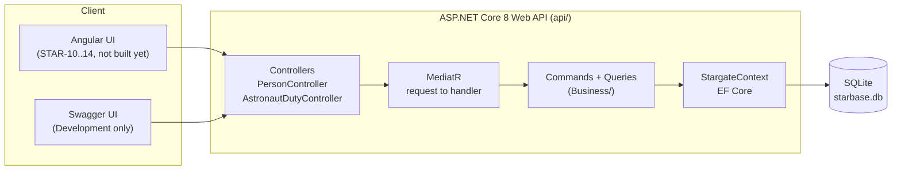
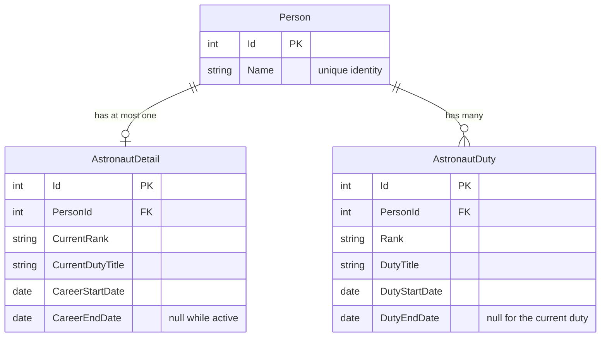
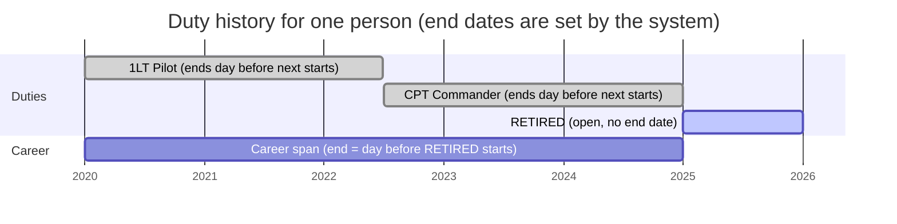
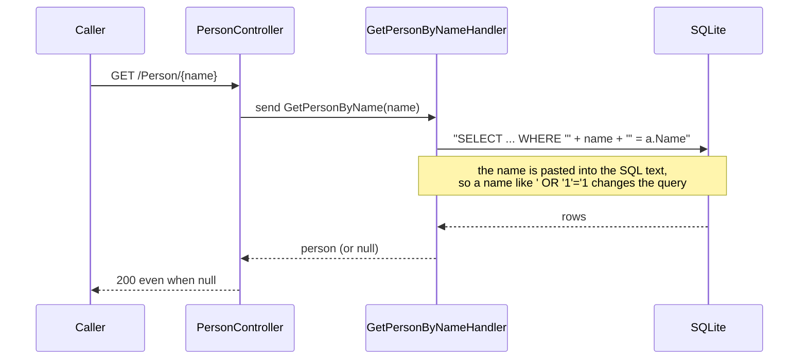
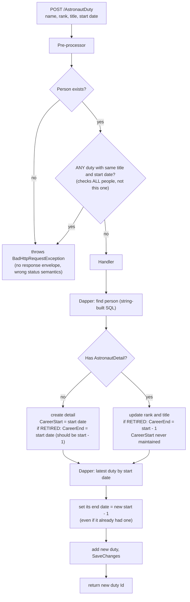
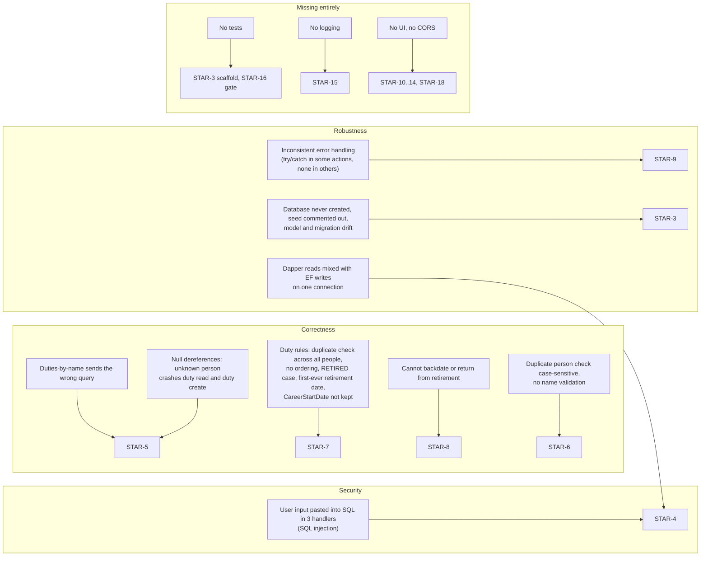
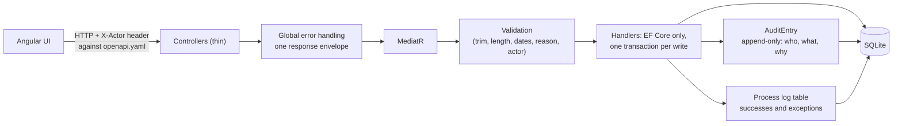

# How the Stargate application works

The Astronaut Career Tracking System (ACTS) keeps a master list of **people** and, for those
who served as astronauts, their **duty history**. This page explains the application as it
was received (the baseline), what is wrong with it, and what it becomes. Process (who builds
what, and how) is in [process.md](process.md). Original exercise text: [EXERCISE.md](EXERCISE.md).
Code references are to `api/`.

## 1. The system at a glance

| Piece | What it is | Where |
|---|---|---|
| Controllers | HTTP routes, turn a result into an HTTP response | `Controllers/` |
| MediatR | A mediator: the controller sends a *request object*, MediatR finds the one *handler* for it. Keeps controllers thin and each use case in one class | `Program.cs`, `Business/` |
| Commands | Requests that change data (`CreatePerson`, `CreateAstronautDuty`) | `Business/Commands/` |
| Queries | Requests that only read (`GetPeople`, `GetPersonByName`, `GetAstronautDutiesByName`) | `Business/Queries/` |
| `StargateContext` | The EF Core database session; maps classes to tables | `Business/Data/` |
| SQLite | A single-file database (`Data Source=starbase.db`) | `appsettings.json` |

**Pattern to name in the interview:** CQRS-style request/handler separation using MediatR
(commands change state, queries read it), with a pre-processor hook for validation.

## 2. The data model

- `AstronautDuty` is the **history** (one row per assignment).
- `AstronautDetail` is a **summary of the latest state**, kept in step with the history. It
  exists only once the person has had a first duty (a person with no assignments has no
  astronaut records).
- Planned additions: a case-insensitive unique index on `Person.Name` (STAR-3), `Reason` on
  `AstronautDuty` (STAR-8), and an append-only `AuditEntry` table (STAR-6).

## 3. The business rules

From the exercise, plus the owner's decisions (`TRACKING.md` D3 to D12):

| # | Rule | Enforced today? | Fixed in |
|---|---|---|---|
| 1 | A person is identified by name (unique) | Partly: case-sensitive check, no DB constraint | STAR-3, STAR-6 |
| 2 | No assignment, no astronaut records | Yes (detail created on first duty) | kept |
| 3 | One current duty at a time | No: nothing prevents two open duties | STAR-7 |
| 4 | The current duty has no end date | Partly | STAR-7 |
| 5 | A new duty ends the previous one the day before it starts | Partly: closes the latest duty even if already closed | STAR-7 |
| 6 | Title `RETIRED` means retired | Case-sensitive match only | STAR-7 |
| 7 | Career end = day before the retired duty starts | Wrong for a first-ever retired duty (uses the start date); right otherwise | STAR-7 |
| D4 | Backdating and return from retirement allowed, with a stored reason; neighbours re-chained | Not supported | STAR-8 |
| D12 | Future start dates allowed, with a reason | Not supported | STAR-8 |

### A worked example: how a timeline chains

When a duty is added, the system (not the caller) sets the previous duty's end date to the
day before the new start date. Retiring sets the career end date to the day before the
retired duty starts. Those two calculations are the core of the exercise.

## 4. The API, as received

| Route | Intended behaviour | What the code actually does |
|---|---|---|
| `GET /Person` | List everyone with astronaut summary | Works (raw SQL via Dapper) |
| `GET /Person/{name}` | One person | Works, but returns 200 with a null person for an unknown name |
| `POST /Person` | Add a person | Body is a bare JSON string; duplicate check is case-sensitive; no validation |
| `GET /AstronautDuty/{name}` | Duty history for a person | **Calls the wrong query** (`GetPersonByName`), so it never returns duties |
| `POST /AstronautDuty` | Add a duty | Several rule bugs (section 6) |

## 5. Request flow today, and where it breaks

### Reading a person (SQL injection)

### Adding a duty (the heart of the exercise)

The pre-processor and the handler are separate steps, there is no transaction around the whole
operation, and nothing checks date order. These are the gaps STAR-7 and STAR-8 close.

## 6. Defects found in the baseline, and the story that fixes each

## 7. What it becomes (target)

| Change | Why it matters |
|---|---|
| EF Core only | Parameterised by construction; removes the injection and the mixed-connection hazard |
| One transaction per write | A failed call changes nothing; no half-updated timeline |
| One response envelope + global error handler | The UI handles every outcome one way; no raw exceptions |
| Audit trail + `X-Actor` | Nothing is hard-deleted; every change records who and why |
| Process logging in the database | An exercise requirement; also what you would use to debug in production |
| Contract first (`openapi.yaml`) | UI and API can be built in parallel and checked against one file |

## 8. Interview prompts this page should help you answer

- *What is wrong with the code you were given?* Section 6, ordered by severity: security first,
  then correctness, then robustness.
- *Why MediatR?* Section 1: one class per use case, thin controllers, a place to hang validation.
- *Walk me through adding a duty.* Section 5 (as received) then section 3 (how the timeline chains).
- *What would you do differently with more time?* The stretch stories: correct or void a duty
  with an audit trail (STAR-20) and real login in place of the self-declared actor (STAR-21).
