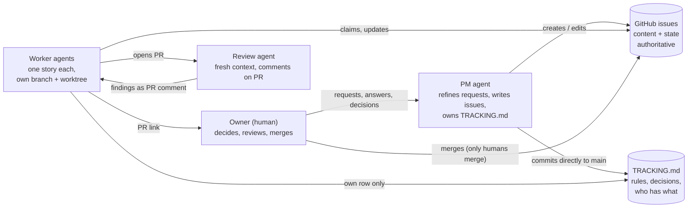
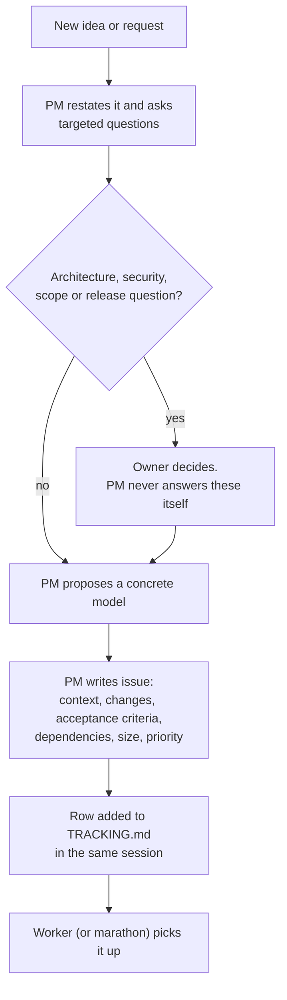
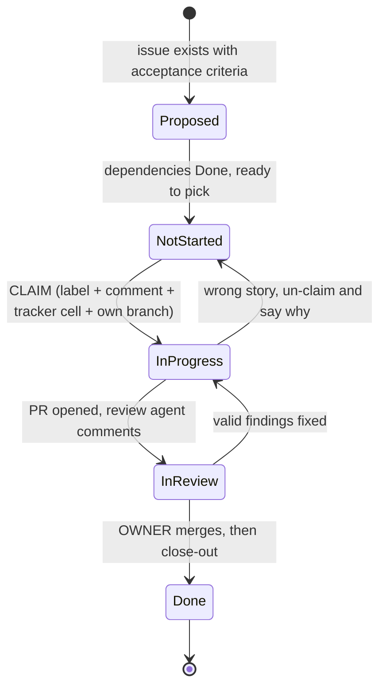
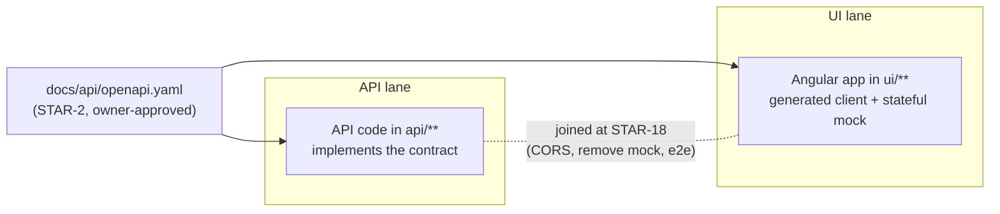
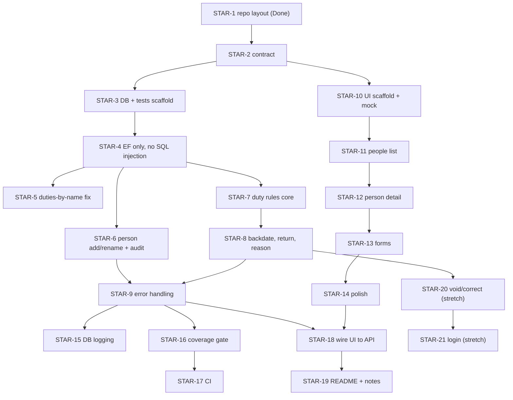
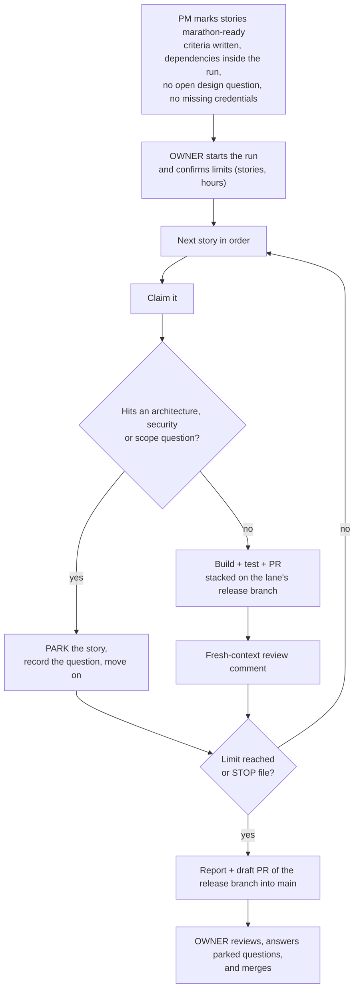
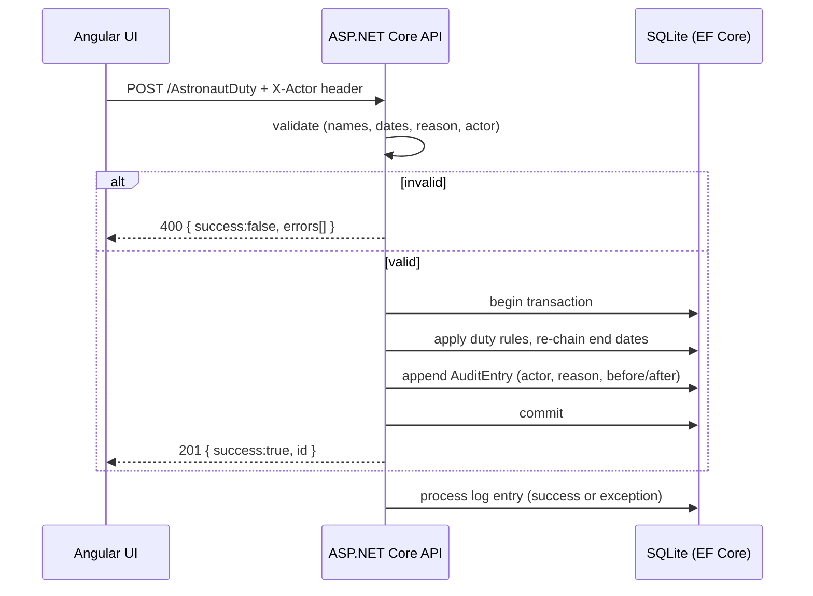

# How this project is run (and why)

This exercise is delivered with AI agents, run by a human-owned process. This page explains
the moving parts, with a diagram for each. It reflects the state on 2026-11-11 and is updated
as the process changes. The detail lives in `TRACKING.md` (rules, decisions, status) and the
GitHub issues (one per story).

**The one-sentence version:** a human owns every decision and every merge; a PM agent turns
requests into well-specified issues and keeps the tracker honest; worker agents each build one
story on their own branch; everything is checked against written acceptance criteria and a
shared API contract.

## 1. Who does what

**Why this split:** the expensive failures on multi-agent work are coordination failures
(two agents on one story, hidden work, state that disagrees), not code quality. So the roles
are separated: the PM never implements, workers never decide scope, and nobody but the owner
merges. If the sources disagree, GitHub issue state wins, then `TRACKING.md`.

## 2. Life of a request

**Why:** a story written with its constraints and rationale lets a worker build it without
re-deriving the design or interrupting a human. Adding the tracker row immediately avoids
numbering collisions (a created-but-untracked story is a trap).

## 3. Story lifecycle and the rules that guard it

| Rule | Why it exists |
|---|---|
| **Claim first, before any research** | Hides no work from other agents. "I need to investigate first" is not an excuse: claiming costs nothing. |
| **Touch only your own tracker row** | A non-owner once marked stories Done while tickets stayed open; board and tickets silently disagreed. |
| **No agent merges, ever** | A person is accountable for what reaches `main`. No auto-merge, no API merge. |
| **Run-and-look for anything client-visible** | Unit tests passing is not proof a UI works. The worker launches it and records what it saw. |
| **Fresh-context review** | A reviewer that did not write the code does not share its blind spots. |
| **Close out every box in the same session** | "PR merged" is not "story done": worktree, branch, notes, exec summary, issue, tracker row. |

## 4. Why a contract comes first

**Why:** the UI is the priority, and it should not wait for the API. If both sides build
against one written contract, they can run in parallel and only meet at integration. The
contract file is the *only* coupling, so a story may not edit it; changing it needs its own
owner-approved PR.

## 5. Dependency map

## 6. What a marathon is

A marathon is **one agent working one lane's stories in order, unattended, inside limits
the owner confirms**. It exists to turn a well-specified backlog into a stack of reviewable
PRs without a human prompting every story.

| Lane | Stories | Owns | Release branch |
|---|---|---|---|
| API | STAR-3..9 | `api/**`, `tests/**` | `release/marathon-api` |
| UI | STAR-10..14 | `ui/**` | `release/marathon-ui` |
| HARD | STAR-15..17 | `api/**`, `tests/**`, `.github/**` | `release/marathon-harden` |

**Why API and UI can run at once:** their paths do not overlap, and their only shared input is
the contract. **Why HARD waits:** logging, coverage and CI touch the same files as the API lane,
so it starts after the API PRs are merged.

**Safety stance:** the PM never starts a marathon and never calls one safe to leave. The run
parks rather than guesses on design questions, a `STOP` file ends it, and nothing merges itself.

## 7. Target request flow for a write (what the API is being built to do)

**Why these choices:** EF Core only (removes the SQL injection); a transaction so a failed
call changes nothing; an append-only audit trail so nothing is ever hard-deleted; one response
envelope so the UI handles every outcome the same way; `X-Actor` as a header so real login
(STAR-21) can replace it later without changing routes or bodies.

## 8. Decisions made by the owner

See `TRACKING.md` D1-D12. Highlights: private repo and personal account only (D1); add and
rename a person (D3); backdating and return from retirement allowed with a stored reason
(D4); EF only (D5); UI is the MVP priority (D6); always an audit trail (D8); `X-Actor` header
(D10); object body, response envelope kept, case-insensitive names (D11); future start dates
allowed with a reason (D12).
