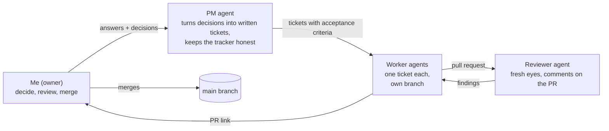
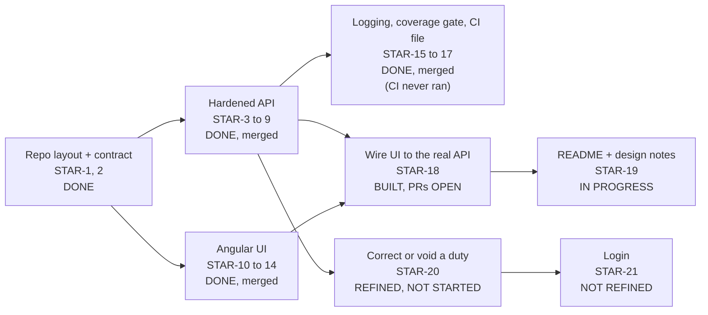

# Talking points: the Stargate ACTS project

Written 2026-11-12 for the project owner, as interview preparation. It is deliberately long and plain.
Read section 1 first, then skim the rest. **Status changes while agents are working: re-check section 7
against `TRACKING.md` and the GitHub issues before you present.**

Honesty rule for this whole page: say what you did, what the AI agents did, and what you checked yourself.
Where a number below comes from an agent's report and not from something you or the PM re-ran, it is marked
**(agent-reported)**.

---

## 1. The 60-second version

> "I was given a small .NET API for tracking astronaut careers. It had real bugs, including SQL injection and
> a route that called the wrong code. I treated it as a delivery project: I fixed and hardened the API, built a
> production-quality Angular UI, added tests, logging and an audit trail, and wrote everything down so it can be
> checked. I did it with AI agents, but with a clear rule: **people decide, agents build, and a person merges.**
> A project-manager agent turned my decisions into written tickets, worker agents built one ticket each in
> separate branches, a separate reviewer agent checked each pull request, and I approved every merge. I checked the
> results myself rather than trusting the agents' reports."

If you remember only one sentence: **"The agents did the typing; I owned the decisions, the rules and the proof."**

---

## 2. The problem, in plain English

ACTS (Astronaut Career Tracking System) is a record of **people** and, for the ones who served as astronauts, their
**duties** (a duty = a rank + a job title + a start date + an end date).

The rules the exercise gives, with an example for each:

| Rule | Example |
|---|---|
| A person is identified by their name | There is only one "Nadia Okafor" |
| Not everyone is an astronaut | "Ellen Voss" is in the list but has no duties, so no astronaut record |
| Only one current duty at a time | Nadia is a "Flight Engineer" now; she cannot also be a "Commander" now |
| The current duty has no end date | Her Flight Engineer duty is open-ended |
| A new duty ends the old one the day before | Promoted on 1 July: the old duty ends 30 June |
| A person is "Retired" when their duty title is `RETIRED` | Duty title `RETIRED` = retired |
| Career end date is one day before the retired duty starts | `RETIRED` starts 1 Jan, career ended 31 Dec |

The task: find and fix the flaws, enforce the rules, defend against bad input, add tests (over 50% coverage),
log successes and errors in the database, and, as the encouraged extra, build a good web UI.

---

## 3. What was wrong with the code I was given

About 1,000 lines of C#. It compiled, but it was not safe or correct. In plain terms:

| # | What was wrong | Why it matters | How it was fixed |
|---|---|---|---|
| 1 | **SQL injection**: user input was pasted straight into SQL text in three places | Someone could type a name like `' OR '1'='1` and read or damage the database. The most serious flaw | All data access rewritten with Entity Framework (parameterised); the Dapper library was removed |
| 2 | The "get duties by name" route called the **wrong query** | It never returned duties at all | Fixed and tested |
| 3 | Unknown names crashed (null reference) or returned "200 OK" with nothing | Misleading and unstable | Proper 404 responses |
| 4 | **Rule bugs** when adding a duty: duplicate check across all people, no date ordering, `RETIRED` case-sensitive, first retirement got the wrong career end date | Wrong data in the exact thing the system exists to keep right | One rules engine that works on the person's whole timeline inside a transaction |
| 5 | No way to **update** a person; `POST /Person` took a bare string; no validation | The brief asked for add/update | Add plus rename, validated, with clear errors |
| 6 | **Database never created**; seed data commented out; no unique name index | It could not even run from scratch | Migrations run on start, sample data seeded in Development, unique case-insensitive name index |
| 7 | Model and migration **disagreed** | Latent runtime errors | Fresh migration, dates changed to date-only |
| 8 | Inconsistent **error handling** (some routes caught everything and leaked internal messages) | Leaks internals, behaves differently per route | One global handler, one response shape, no internals ever returned |
| 9 | Mixed Dapper reads with EF writes on one connection | Fragile and hard to reason about | Everything on EF |
| 10 | **No logging, no tests, no CORS, no UI, no `.gitignore`** (stale build output committed) | The brief asks for all of these | Added (see section 4) |

The full list lives in `TRACKING.md` under "Baseline findings", with the story that fixed each one.

---

## 4. What the finished system does

### 4.1 The API (ASP.NET Core 8, MediatR, Entity Framework Core, SQLite)

Six routes:

- `GET /Person` list everyone, with a status of None / Active / Retired
- `GET /Person/{name}` one person
- `POST /Person` add a person (body is `{ "name": "..." }`)
- `PUT /Person/{name}` rename a person
- `GET /AstronautDuty/{name}` the duty history, newest first
- `POST /AstronautDuty` add a duty

How a write is processed (the same shape every time):
1. **Validate** the input (trimmed, lengths, dates, the actor header, reasons). Bad input = 400 with a list of field errors.
2. **Look up** the person. Not found = 404.
3. **Check conflicts** (duplicate name, duplicate start date). Conflict = 409.
4. **Apply the rules** to the person's whole timeline **inside one database transaction**, so a failed call changes nothing.
5. **Write an audit entry** in the same transaction (who, what, why, before and after).
6. **Log** the operation (success or failure, how long it took).

Every response uses one envelope: `{ success, message, responseCode }` plus `errors[]` for validation, and the HTTP status always
equals `responseCode`. A 500 never shows internals, only a generic message and a trace id.

### 4.2 The rules I added beyond the brief (decisions I made)

- **Backdating** is allowed (fixing a late entry), and **returning from retirement** is allowed. Both **require a written reason**,
  stored with the duty. Future start dates also need a reason.
- Adding a backdated duty **re-chains** the neighbours so there are never gaps or overlaps.
- **An actor on every change.** Every write needs an `X-Actor` header (who is doing this). It is stored in an **append-only audit
  table**. The database itself refuses to update or delete audit rows. The actor is self-declared for now (see "not done": login).

### 4.3 The UI (Angular 21, Angular Material, custom dark "mission control" theme)

- **People list**: search, filter by status, sort, status badges that use an icon and text (not colour alone).
- **Person page**: header plus a vertical **duty timeline**, newest first, current duty highlighted, "Present" for the open duty,
  a distinct style for `RETIRED`, reason shown when present.
- **Forms**: add a person, rename, add a duty. The reason field becomes required and shows an explanation banner when the date is
  backdated, in the future, or the person is retired. Server errors appear on the matching field. No double-submits.
- **"Acting as" box** in the top bar: you enter your name once; it is sent as `X-Actor`. Writes stay disabled until it is set.
- **Production polish**: loading, empty and error states on every screen, an "API is unreachable" banner, keyboard access, screen-reader
  announcements, responsive layout (phone to desktop), reduced-motion support, page titles, bundle size limits.
- A **stateful mock API** (a small Node server) so the UI could be built and tested before the real API was ready.

### 4.4 Logging, audit and tests

- **Process logging in the database** (a `LogEntry` table): every command and query is logged with its name, outcome and duration;
  unexpected errors are logged with the stack trace and the same trace id the caller sees. Logs are written through a background queue, so a
  logging problem can never break a request. You can read them with plain SQL (examples are in the logging PR, #40).
- **Audit trail**: separate from logs. It answers "who changed what, when, why".
- **Tests**: real SQLite and real migrations (no faking of the database), plus the whole API run in memory. The test suite fails if
  line coverage drops below 50%. Reported coverage is far higher (see section 10).

---

## 5. How I built it with AI agents (the part they will ask about)

### 5.1 The idea in one picture

Think of it as a small software team where **I am the product owner and the only person who can approve work into the main branch.**

### 5.2 The rules, and the reason for each (this is the "I understand what is going on" material)

| Rule | Plain reason |
|---|---|
| **Agents never merge.** A person does | Someone accountable must decide what reaches `main`. It stops a mistaken agent from shipping |
| **Claim before you start.** Mark the ticket "in progress" before reading any code | Stops two agents building the same thing, and stops hidden work |
| **Touch only your own row** in the tracker | Once, one agent marked others' work done while the tickets were still open; the records disagreed |
| **Architecture, security and scope questions go to me**, not to the PM or the agent | Those are judgement calls with consequences; an agent that guesses silently is the dangerous case |
| **A fresh reviewer agent checks each PR** | The agent that wrote the code shares its own blind spots |
| **Run it and look** for anything visible | Passing tests do not prove a screen works |
| **Contract first**: the API's shape is written down in `docs/api/openapi.yaml` before the lanes build | The UI and API teams can work at the same time and still fit together |
| **Run all tests locally and post the results on the ticket** (decision D13) | My GitHub Actions minutes ran out, so CI cannot be evidence. "Green" must never be claimed for something that was not run |
| **Evidence over claims** | I re-ran builds and tests on a fresh copy of the repository instead of trusting the reports |

### 5.3 "Marathons"

A **marathon** is one agent working a whole lane of tickets in order, unattended, inside limits I set (number of stories, hours).
Rules: the PM marks a ticket "marathon-ready" only if its acceptance criteria are written, its dependencies are done, and there is no open
design question. If a marathon hits a design or security question it **parks** the story instead of guessing. A `STOP` file ends the run. I start
every marathon; the PM never does and never calls one "safe to leave".

Lanes so far (all merged by me unless noted):

| Lane | Stories | Result |
|---|---|---|
| Contract | STAR-2 | The API contract (OpenAPI), reviewed by me |
| API | STAR-3 to STAR-9 (7 stories) | The fixed and hardened API, landed as one release PR |
| UI | STAR-10 to STAR-14 (5 stories) | The Angular app, against the mock |
| Hardening | STAR-15 to STAR-17 (3 stories) | Logging, coverage gate, CI workflow |
| Integration | STAR-18, STAR-19 | STAR-18 built and in review, STAR-19 in progress (see section 7) |

### 5.4 What I personally did versus what the agents did

Be straightforward about this. **The agents wrote nearly all the code.** What I did:
- Set the goal, the priorities (UI is the MVP) and every rule listed in section 6.
- Answered every design question the agents raised (the ones only an owner can answer).
- Reviewed and merged every pull request.
- Chose the process: lanes, marathons, claim rules, evidence rules.
- Checked results independently (fresh clone, build, run the tests) and caught disagreements with the agents' reports (section 9).

---

## 6. Decisions I made, and why

Full list with exact wording: `TRACKING.md`, "Decisions recorded" (D1 to D15).

| # | Decision | Why |
|---|---|---|
| D1 | Private repo, personal account only | Keep the exercise separate from other work |
| D3 | "Add/update a person" = **add** + **rename** (409 on duplicates) | The brief says "add/update by name"; the name is the identity, so update means rename |
| D4 | Allow backdating and return from retirement, each **with a stored reason** | Real careers have corrections and comebacks; the reason keeps it explainable |
| D5 | Entity Framework only, remove Dapper | Removes the injection risk and the mixed-connection fragility |
| D6 | UI is the MVP; build API and UI **in parallel** against a contract | Show the encouraged part well without waiting on the API |
| D8 | **Always an audit trail**; nothing is hard-deleted | An astronaut record needs "who changed what and why" |
| D10 | `X-Actor` **header** for who made a change | A header, not a body field, so real login can replace it later without changing any route |
| D11 | Object body for `POST /Person`; keep the response envelope; names unique case-insensitively | Clearer contract; consistency with the existing code; SQLite only folds ASCII case, so the app also checks |
| D12 | Future start dates are **allowed but need a reason** | Records what is planned without making "current duty" ambiguous |
| D13 | **No reliance on GitHub CI**; run everything locally, post results on the ticket | Out of free CI minutes; honesty about what was actually run |
| D14 | UI gets the API address from build-time config (localhost only); document `traceId` in the contract; case-only rename is applied and audited; focus on a person page only moves after in-app navigation | Simplest correct option for each; the last one keeps the "skip to content" link usable for keyboard users |
| D15 | Stretch story STAR-20: corrections can change rank, title and start date; one story; a voided duty is final | Scope for the optional extra |

---

## 7. Status: done, in progress, not done

*(As of 2026-11-12. Re-check before presenting.)*

### Done (merged to `main` by me)

- The contract, the fixed API, the Angular UI, the logging, the audit trail, the coverage gate and the tests.
- 21 tracked stories exist; stories 1 to 17 are built and merged.

### In progress

- **STAR-18**: connect the UI to the real API (CORS, remove the mock as the default, an end-to-end test). **Built; its two PRs (#45
  contract, #46 integration) are open waiting for my review and merge.** Until they are merged, the UI's default build still talks to the
  **mock** API, not the real one. Say this plainly if asked. The two PRs are stacked, so merge them top-down (#46 first, then #45) or
  check the diff contains everything.
- **STAR-19**: the README and design notes. Being written now by the same marathon.

### Not done (and what to say)

| Not done | What to say |
|---|---|
| **STAR-20**: correct or void a duty, with history | "An optional extra. I refined it and decided its scope, but I have not built it; I would not rush it into the deadline." |
| **STAR-21**: real login instead of a self-declared name | "A stretch goal. Today the actor is self-declared, which is fine for an exercise but not for production. I designed it so login can replace it without changing any route." |
| **CI has never run** | "I wrote the pipeline file and the commands in it run locally, but my free CI minutes ran out, so I have no green CI run to show. I would not claim otherwise." |
| End-to-end through the real API in a browser | "Waiting on STAR-18. Each half was tested on its own; the join is what STAR-18 proves." |
| Screen readers, non-Chromium browsers | "Automated accessibility scans passed on Edge; I have not tested with a real screen reader." |
| Log retention | "The log table grows forever. Easy follow-up: prune old rows." |

---

## 8. Limits and risks, honestly

- **Single-writer database.** SQLite allows one writer. The API serialises writes with an in-process lock. It is correct for one API
  process; it would not protect several API processes sharing one file. Production answer: a server database.
- **Self-declared actor.** Anyone can type any name. The audit trail records what was claimed, not what was proven.
- **No authentication or authorisation** at all, by design for the exercise.
- **Local-only configuration.** The API address is baked into the UI build and is localhost only (decision D14).
- **Agent output is only as good as the spec.** The best defence was precise tickets with acceptance criteria, and independent checks.

---

## 9. Mistakes and lessons (good interview material: it shows judgement)

1. **Stacked pull requests merged in the wrong order.** The UI work was a chain of PRs, each pointing at the one before. Merged
   bottom-up, most of the work never reached `main` and needed a recovery PR. Lesson, now written in the tracker: merge top-down, or
   land one release PR, and check the diff contains every story before merging. The API agent then offered a one-PR route, which
   worked.
2. **An agent's report did not match my check.** The UI agent said all 229 UI tests pass; on my first fresh run, 4 failed (an accessibility
   test, probably timing under load); on a second run all 229 passed. I did not call it fixed, I recorded it as a possible flaky test.
3. **Two agents wrote to the same tracker file at once** and one agent's edits were lost. Fixed by pulling first and committing in one
   step, and by telling agents to commit the tracker only from a clean pull.
4. **I edited the acceptance criteria of stories that were already delivered** when I added the no-CI rule, and then reversed it,
   because rewriting finished criteria to fit what was built misrepresents the record. The rule now applies only to stories not yet built.
5. **A launcher-style preflight failed** because a development server was still holding the build output. Boring, but it is why every
   marathon starts from a clean tree and free ports.
6. **Running out of CI minutes** meant the CI workflow is unproven. I chose to say so openly rather than hide the red marks.

**Check before you say "I merged every PR".** GitHub records your account as the merger of every pull request, but it cannot tell a
click by you from an agent using your saved login. The first UI stack (#24 to #28) was merged within about 90 seconds. Only claim
the "a person merges" rule if you personally clicked each merge. If an agent used your token for some, say that instead: "the rule was
that agents do not merge; I found that it was not enforced technically, only by instruction, and I would enforce it with branch
protection that requires a human review."

---

## 10. Numbers cheat sheet

Say "about" and cite the source.

| Fact | Number | Source |
|---|---|---|
| Original code | about 1,000 lines of C# | Read by the PM |
| Defects found in the baseline | 12 groups (see section 3) | `TRACKING.md` |
| Stories planned / built and merged | 21 / 17 (STAR-1 to STAR-17) | `TRACKING.md`, GitHub |
| API tests | 139 on the API lane, verified on a fresh clone by the PM; 156 after hardening **(agent-reported)** | PR #38 and PR #43 |
| API line coverage | about 99% **(agent-reported)**; the build fails below 50% | PR #43, `docs/testing.md` |
| UI tests | 229 UI tests + 15 mock-server tests; the PM re-ran 229, all passing on the second run | PR #30 and the PM's check |
| Accessibility | axe scan: 0 violations on 18 scenarios in Edge **(agent-reported)** | PR #30 |
| Build warnings | 0 (`-warnaserror`) | PR #38, verified by the PM |
| Marathons | 4 (UI, API, hardening done; integration running) | tracker |
| Decisions recorded | D1 to D15 | `TRACKING.md` |
| Pull requests | 40+ (one per story, plus release and docs PRs) | GitHub |

---

## 11. A five-minute demo script

Use `start-demo.bat` (double-click, in the repo root). It starts the API and the UI, waits until both answer, then opens the app in a new,
clean browser window. `stop-demo.bat` stops everything. API docs open at `http://localhost:5204/swagger`.

1. **Show the problem (30 s).** Open `docs/app.md` section 6, the defect map: "this is what I was given."
2. **People list (45 s).** Search a name, filter to Retired, point at the status badges ("icon and text, not colour alone").
3. **Person page (60 s).** Open Priya Raman: show the timeline, the open duty ("Present"), the `RETIRED` entry, and the
   "returned to flight status" reason. "This person retired and came back; the reason is stored."
4. **Write something (90 s).** Click "Acting as", enter your name. Add a duty with a date earlier than the latest: the reason banner
   appears and the field becomes required. Submit. Show the timeline re-chain with no gaps.
5. **Show an error (30 s).** Try to add a person that already exists: inline 409 error on the field.
6. **Behind the curtain (45 s).** Swagger for the API; the contract file; "tests run on real SQLite"; the logs table.
7. **The process (30 s).** Show `docs/process.md` section 1 diagram: "people decide, agents build, a person merges."

Until STAR-18 is merged, the UI shows data from the **mock** API; say so if you demo before then.

---

## 12. Likely questions, with straight answers

**Q: How much of this did the AI write?**
Nearly all the code. I owned the goal, the rules, the decisions, the review and every merge, and I verified the results myself.

**Q: How do you trust AI-written code?**
I do not trust it, I check it. Four layers: precise tickets with acceptance criteria; a fresh reviewer agent per PR; tests that fail
if the behaviour is wrong (real database, real migrations); and my own fresh-clone re-run of builds and tests. When an agent's report and my check disagreed, I recorded the disagreement.

**Q: What stops an agent from doing something harmful?**
A person is the only one who can merge. Agents cannot change repository settings. Questions on security, architecture and scope are
parked for me. Agents work in separate branches and folders. A stop file ends a marathon.

**Q: What was the most important bug?**
SQL injection: user input pasted into SQL. Fixed by moving everything to Entity Framework and proving it with tests that try injection strings.

**Q: Why MediatR?**
One class per use case; thin controllers; a place for logging and validation to hang. The commands change data, the queries only read.

**Q: Why contract-first?**
So the API and UI could be built in parallel and still fit. A test checks that the running API's routes and status codes match the contract file.

**Q: Why a reason field and an audit trail?**
Because correcting history is risky. If a duty can be backdated, someone must be able to see who did it and why.

**Q: Why SQLite? Would it scale?**
It is simple for an exercise. It allows one writer at a time, so I serialise writes; for production I would move to a server database
and a real connection pool.

**Q: What would you do next?**
Land the end-to-end wiring (STAR-18), get CI actually running once I have minutes, add real authentication so the actor is verified,
add log retention, then the correct/void feature.

**Q: What would you change about how you ran the agents?**
Make the PR stacking safer from the start (one release PR), give each agent its own copy of the tracker file, and run CI so evidence
does not rely on trust.

**Q: What is the weakest part?**
CI never ran, so I cannot show a green pipeline. And until the integration story lands, the UI and API have not been proven together in a
browser, only each against the contract.

**Q: Did the agents ever disagree with you or get things wrong?**
Yes: section 9. The point is that the process caught each one.

---

## 13. Words you may be asked about

| Word | Meaning in one line |
|---|---|
| **Contract / OpenAPI** | A written description of every route, input and output, which both sides must obey |
| **MediatR** | A library that sends a request to exactly one handler class |
| **Migration** | A versioned change to the database structure |
| **Transaction** | A group of database changes that all succeed or all vanish |
| **Audit trail** | A permanent record of who changed what and why |
| **CORS** | A browser rule that decides which website may call which API |
| **Mock API** | A fake API for building the UI before the real one exists |
| **Marathon** | One agent, many tickets in a row, inside limits I set |
| **Worktree** | A second checked-out copy of the repo, so each agent has its own folder |
| **Stacked PRs** | PRs where each builds on the previous one's branch |
| **CI** | Automatic build and test on every PR (not running for me; no minutes) |
| **Acceptance criteria** | The written, checkable conditions that mean a story is done |
